# Haven-Store 二手商品交易平台 · 作品介绍文档

> 一句话简介：Haven-Store 是一个「商品发布 → 附近浏览 → 私信咨询 → 下单支付 → 收货评价 → 举报处理」全链路闭环的全栈二手交易平台，后端 Spring Boot 2.7 + MyBatis-Plus，前端 Vue 3 + Element Plus，MySQL 8 + Redis 7 为唯二外部依赖，零配置即可在本机 10 分钟内跑通、并由 340 项自动化断言验收。

| 项目名称 | Haven-Store（二手商品交易平台） |
| --- | --- |
| 作品形态 | Web 全栈应用（前台用户端 + 后台管理端），前后端分离，单仓库交付 |
| 代码规模 | 后端 128 个 Java 文件约 12,600 行；前端 54 个 Vue/JS 文件约 15,200 行；SQL 建表脚本 12 张表 |
| 技术栈 | Spring Boot 2.7.12 · MyBatis-Plus 3.5.3.1 · MySQL 8 · Redis 7 · JWT(JJWT 0.11.5) · Vue 3.4 · Pinia · Element Plus 2.4 · ECharts 5.5 · Vite 5 |
| 代码仓库 | GitHub：`https://github.com/istilljump/Haven-Store`（Public，含 CI 流水线） |
| 演示账号 | 普通用户 `testuser1 / 123456`、`testuser2 / 123456`；管理员 `admin / admin123`（后台 `/admin`） |
| 本版文档 | v1.0，2026-10-16；本轮补充了 44 件贴近真实场景的演示商品数据与全套运行截图 |

---

## 一、项目详情

### 1.1 这是一个什么项目

Haven-Store 是一个面向校园与同城场景的**二手闲置交易平台**。它不是一个只完成增删改查的练手项目：平台把「发布商品」作为起点，把最容易出问题的环节——**同城面交的定位筛选、买卖双方的即时沟通、下单后的库存与状态一致性、以及纠纷举报的处理闭环**——都用可运行、可断言的方式实现了出来。

系统由两套界面组成：

- **用户端**（`/home` 起）：首页、商品列表与搜索、商品详情、商品发布向导、我的发布、购物车、订单、私信、通知中心、个人资料；
- **管理端**（`/admin` 起）：数据概览、用户管理、商品管理、订单管理、分类管理、评论管理、举报处理、系统消息、系统设置。

### 1.2 它解决什么问题

| 真实痛点 | 本项目的做法 |
| --- | --- |
| 二手交易最看重「离得近、当面看货」，普通关键词搜索满足不了 | 商品支持线下交易坐标，列表页提供「附近商品」模式，按球面距离排序（Haversine + 矩形预过滤） |
| 卖家不知道自己的闲置该标多少钱，报价全凭感觉 | 发布向导内置「AI 智能估价」，依据标题/描述/成色/分类给出建议价区间与置信度，并可一键回填 |
| 买家想先问清楚再下单，但平台没有沟通渠道 | 商品级私信：会话与商品绑定，商品咨询和讨价还价都在平台内留痕 |
| 下单后超时不付款，商品被长期占住 | 定时任务每 10 分钟清理：30 分钟未支付订单自动取消并释放商品 |
| 后台设置只是摆设，改了不生效 | 上传白名单、价格上限、密码强度、登录失败锁定等设置**真实约束业务**，不是只存一张配置表 |
| 评价不可信、举报没人管 | 仅购买过（已支付/已完成）的用户可评价并带「已验证购买」标识；举报直达后台并记录处理动作与处理人 |

### 1.3 功能清单

**用户端（12 项）**：账号注册与登录（JWT）· 首页搜索与分类导航 · 商品列表（关键词/分类/价格区间/排序/附近模式）· 商品详情与图片相册 · 商品发布向导（四步，含 AI 估价）· 我的发布（上架/下架/重新上架/彻底删除）· 收藏与购物车 · 下单与模拟支付 · 订单列表与详情、确认收货、取消订单 · 商品评价（已验证购买）· 商品级私信 · 通知中心与站内消息 · 个人资料与改密。

**管理端（10 项）**：数据概览（趋势折线 + 分类环形图 + 最近商品/消息）· 用户管理（新增/编辑/启停用/重置密码）· 商品管理（审核上下架/彻底删除）· 订单管理 · 分类管理（排序与启停用）· 评论管理 · 举报处理（下架商品/驳回）· 系统消息群发 · 数据导出（用户/商品 CSV）· 系统设置（站点/上传/交易/联系方式/安全五组）。

### 1.4 数据模型

`backend/sql/01-schema.sql` 一次性建出 12 张表，做到「环境即代码」：

| 表 | 作用 | 关键设计 |
| --- | --- | --- |
| `user` | 用户（含角色、状态） | 口令 BCrypt 存储；`status` 支持禁用即时生效 |
| `category` | 商品分类 | 唯一名称 + 排序值 + 启用状态 |
| `product` | 商品主表 | 成色/交易方式/品牌型号/经纬度；`(status, category_id)` 联合索引 |
| `product_image` | 商品多图 | 首图冗余到 `product.cover_image`，列表页免联表 |
| `product_order` / `order_item` | 订单与明细 | 一个订单可含多件；状态机 待支付→已支付→已完成/已取消 |
| `comment` | 评价 | 记录评分与「已验证购买」 |
| `user_product_relation` | 收藏/浏览关系 | 关系类型区分收藏与浏览 |
| `private_message` | 商品级私信 | 会话由 (双方, 商品) 唯一确定 |
| `system_message` | 站内消息/公告 | 管理员群发写入 |
| `report` | 举报 | 待处理/已处理 + 处理动作 + 处理管理员 |
| `system_setting` | 系统设置 | 五组 JSON 设置，驱动前台与后台行为 |

### 1.5 本轮演示数据现状（2026-10-16）

为了让演示时列表「看起来完整、品类多样」，本轮通过**真实接口**（不是直接写库）灌入了一批贴近真实业务场景的商品数据：

| 维度 | 现状 |
| --- | --- |
| 商品总数 | 46 件（2 件仓库自带种子商品 + 44 件本轮演示商品），其中在售 42 件、已售出 4 件 |
| 品类覆盖 | 8 个品类全部有货：手机数码 9 · 图书教材 6 · 电脑办公 5 · 家用电器 5 · 服饰鞋包 5 · 美妆个护 5 · 运动户外 4 · 其他闲置 3（在售口径） |
| 价格跨度 | ¥55（考研英语真题）～ ¥6488（iPhone 14 Pro），同品类内含高中低价位 |
| 商品信息完整度 | 均含标题、描述、成色、交易方式、品牌、型号、购买时间、标签、备注、联系人；13 件线下商品带真实城市坐标（北京/上海/深圳/成都/杭州/广州/南京）用于 LBS 演示 |
| 商品图片 | 每件 1～3 张（主图 + 细节图/配件图/包装图），共 75 张，走真实上传接口落盘 |
| 交易与互动数据 | 3 笔订单（待支付/已支付/已完成各 1 笔，其中 1 笔含 2 件商品）· 1 条 5 星评价 · 3 个私信会话（含商品咨询上下文）· 2 条平台公告 · 1 条待处理举报 |

---

## 二、项目详情：使用方式

### 2.1 环境要求

| 组件 | 版本要求 | 用途 | 备注 |
| --- | --- | --- | --- |
| JDK | 8+（推荐 17/22） | 后端编译运行 | 本次演示在 JDK 22 上运行 |
| Maven | 3.6+ | 后端构建 | 仓库 `.tools/` 内自带 3.9.16 可用 |
| Node.js | 18+（含 npm） | 前端构建与开发 | 依赖版本由 `package-lock.json` 锁定 |
| MySQL | 8.0+ | 业务数据库 | 建库脚本 `backend/sql/01-schema.sql` |
| Redis | 7+（6.x 可用） | 登录态缓存、防爆破计数、估价缓存 | 不可用时项目自动降级 |
| Python | 3.8+ | 运行冒烟测试 | 纯标准库，无第三方依赖 |

### 2.2 十分钟跑通

**Windows 一键路线**

| 步骤 | 操作 | 预期结果 |
| --- | --- | --- |
| 1 | `git clone https://github.com/istilljump/Haven-Store.git && cd Haven-Store` | 拿到全部源码 |
| 2 | 双击 `scripts\start-dev-services.bat` | 免管理员拉起 MySQL 与 Redis；首次运行自动建库 `secondhand_market` 并导入 12 张表与种子数据 |
| 3 | 双击 `scripts\rebuild-backend.bat` | 生成 `backend/target/second-hand-market-1.0.0.jar` |
| 4 | `java -jar backend\target\second-hand-market-1.0.0.jar` | 控制台出现 `Started SecondHandMarketApplication` |
| 5 | `cd frontend && npm install` | 依赖安装完成 |
| 6 | `cd frontend && npm run dev` | 浏览器打开 `http://localhost:3000` |
| 7 | `python tests/api_smoke_test.py` | 输出 `通过: 340   失败: 0` |

**Linux / macOS 路线**：`docker compose -f config/docker-compose.yml up -d` 拉起 MySQL 与 Redis（compose 内自动建库导种子），随后后端 `mvn clean package -DskipTests && java -jar backend/target/*.jar`、前端 `npm install && npm run dev`，其余一致。仓库同时提供 `backend/Dockerfile`、`frontend/Dockerfile` 与 `config/nginx.conf`，可直接容器化部署。

**所有敏感配置都写成 `${环境变量:默认值}`**（数据库口令、JWT 密钥等），因此本机零配置即可跑通，部署时用环境变量覆盖即可，不需要改任何代码或配置文件。

### 2.3 账号与入口

| 角色 | 账号 | 密码 | 入口 |
| --- | --- | --- | --- |
| 管理员 | `admin` | `admin123` | `http://localhost:3000/admin` |
| 普通用户 | `testuser1` | `123456` | `http://localhost:3000/auth/login` |
| 普通用户 | `testuser2` | `123456` | 同上（演示买卖双方与私信互动） |

### 2.4 怎么算「跑通了」

复现是否成功不靠「页面能打开」的感觉，而看三条硬口径：

1. `curl http://localhost:8080/api/health` 返回 `{"code":200,...}`；
2. 用 `testuser1 / 123456` 登录后，商品列表能看到「二手 iPhone 12」及本轮演示商品；
3. `python tests/api_smoke_test.py` 输出 **通过 340 / 失败 0**；`cd backend && mvn test` 输出 **Tests run: 66, Failures: 0, Errors: 0**。

### 2.5 演示数据一键复现

本轮演示数据由 `scripts/seed_demo_products.py` 生成，可随时重跑或改造：

```
python scripts/seed_demo_products.py                 # 给 testuser1 灌 44 件商品（真实走上传+发布接口）
python scripts/seed_demo_products.py --dry-run       # 只合成商品图，不调用任何接口
python scripts/seed_demo_products.py --user testuser2 --password 123456
```

脚本的演示商品目录（标题/描述/成色/价格/坐标）以数据结构形式写在文件内，商品图用 Pillow + 系统彩色 emoji 字体合成「白底商品照」，因此不引用任何第三方版权图、也不需要外网。脚本对单件失败不阻断整批、最后统一汇总失败明细，可重复执行。

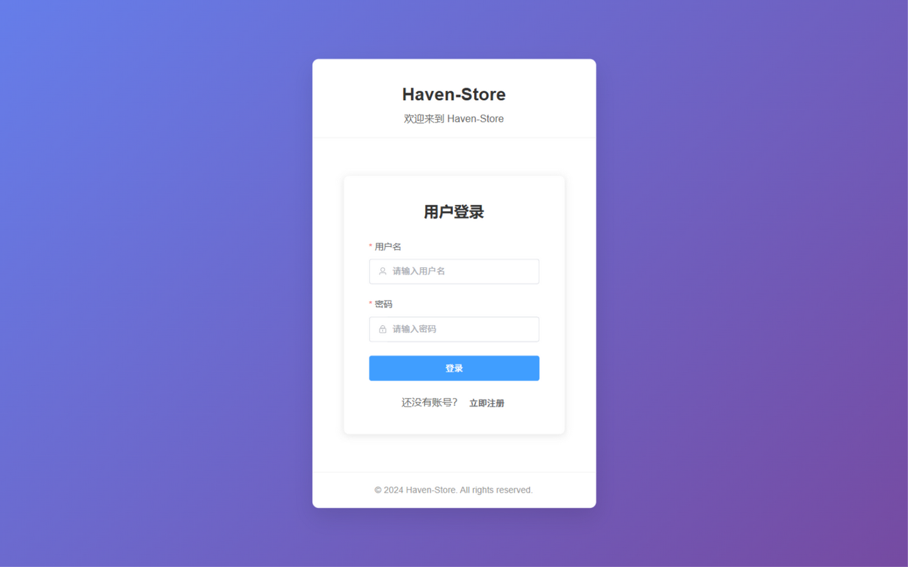

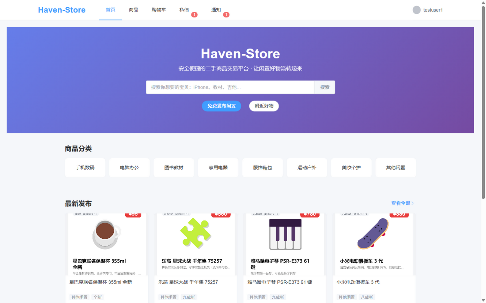

---

## 三、项目亮点

**1）零配置即可复现，且用断言而不是感觉来验收。** 数据库结构与种子数据由一个脚本确定，依赖版本由 `pom.xml` / `package-lock.json` 锁定，配置全部带默认值；验收标准是 `mvn test` 的 66 项单元测试与 `python tests/api_smoke_test.py` 的 340 项接口断言全绿。任何人从仓库零起步，都能在 10 分钟内跑出一致结果。

**2）不是「能跑就行」，而是把交易闭环真正走完。** 发布 → 附近浏览 → 私信咨询 → 加购 → 下单 → 支付 → 确认收货 → 评价（带「已验证购买」标识）→ 举报 → 后台处理，每一步都有对应的接口、页面与状态流转，并有自动化断言覆盖。

**3）附近好物（LBS）真的在网上跑。** 线下交易商品带真实经纬度，附近查询先用矩形范围做粗筛、再用 Haversine 公式算球面距离并按距离排序，兼顾准确性与查询成本，而不是把全部商品取回来在内存里算。

**4）AI 智能估价直接嵌进发布流程。** 发布向导第 1 步即可点「AI 智能估价」，系统按标题/描述长度、品牌型号关键词、成色系数、分类基准价等特征给出建议价、价格区间与置信度，支持一键回填；估价结果按特征组合缓存，管理员可在后台一键关闭该功能。需要说明的是，它目前是**本地规则引擎 + 置信度模拟**的实现（README 中已如实标注，估价含 ±200 元随机波动），不是训练出来的模型，也不依赖任何付费 AI 接口。

**5）后台设置是「活」的。** 上传类型白名单与大小上限、商品价格上限、密码强度策略、登录失败锁定次数与时长、会话超时时间等，都由后台设置真实驱动业务校验——把设置改成「仅允许 jpg」，上传 png 就会立刻被拒。冒烟测试专门断言了这条链路。

**6）安全上做了该做的事，而不是只做界面。** JWT + Redis 登录态（禁用账号即时失效）、按后台策略的登录防爆破、BCrypt 口令、上传文件魔数校验（防伪装脚本）、CSV 导出公式注入防护、私信/商品/订单的越权校验、举报处理留痕。

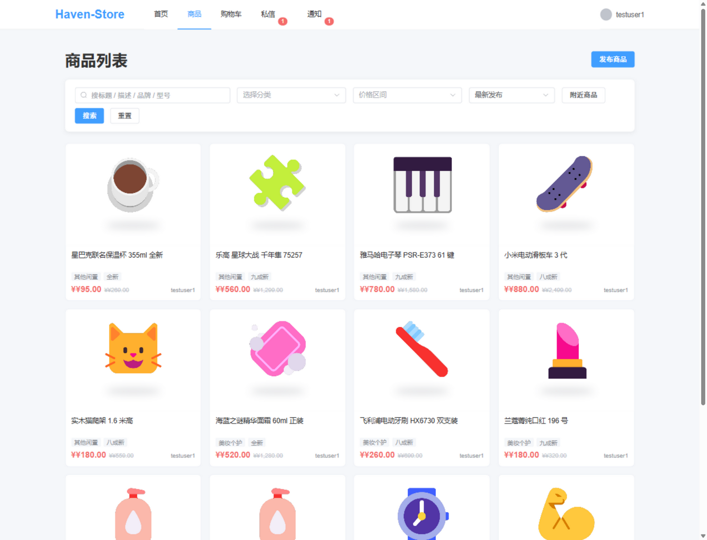

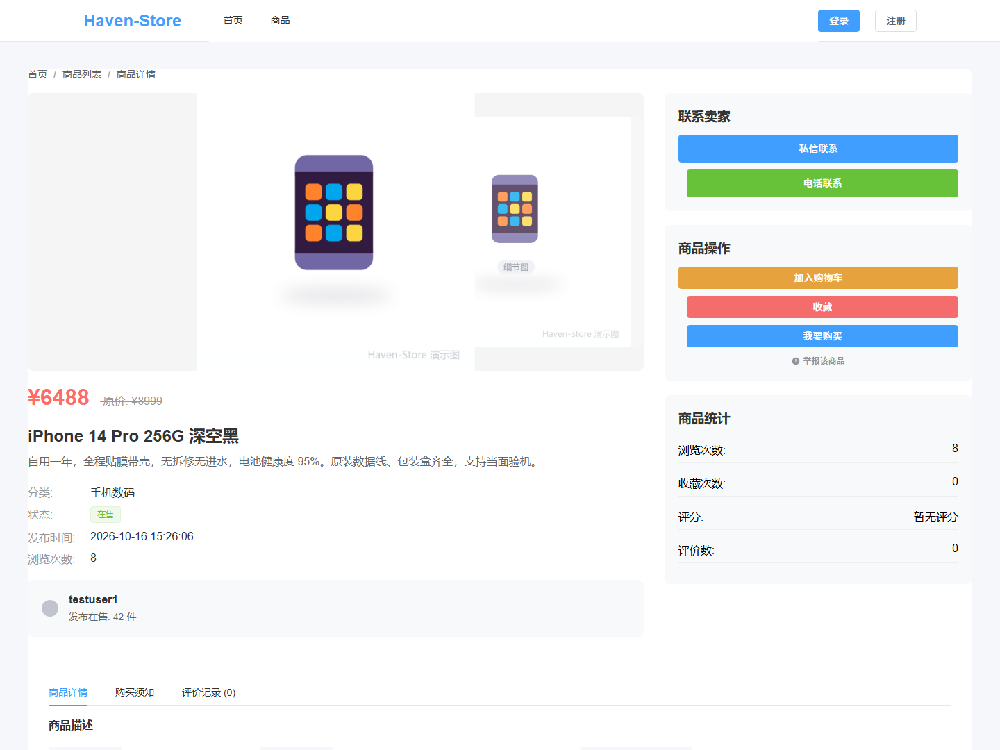

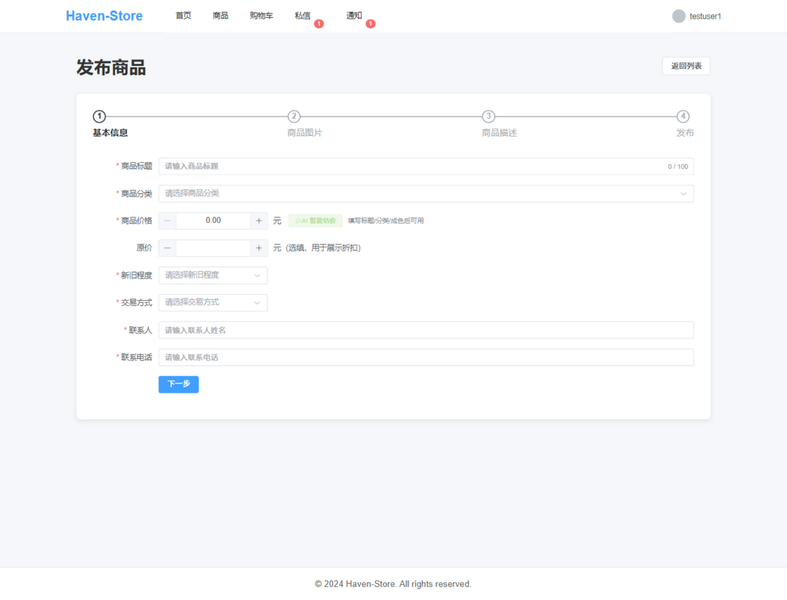

---

## 四、AI 测试技术落地使用情况概述

本项目的开发方式是「人定标准、AI 写实现」。在这种方式下，最大的风险不是代码写得慢，而是**AI 改坏了自己看不见的地方**。因此项目把测试当作与代码同等重要的交付物来建设，形成了三层验收 + 两类专项（安全、性能）的落地方式。

### 4.1 总体思路：断言驱动，而不是靠人肉点页面

| 层次 | 资产 | 规模 | 解决什么问题 |
| --- | --- | --- | --- |
| 单元/业务规则 | `backend/src/test`（6 个测试类，JUnit + Mockito） | 66 项测试方法 | 服务层业务规则、边界条件、异常分支 |
| 接口冒烟（端到端） | `tests/api_smoke_test.py` | 1373 行、31 个用例分组、340 项断言 | 真实 HTTP 全链路：注册登录、拦截器鉴权、发布、搜索、下单支付、私信、举报闭环、后台全部页面、导出、设置生效 |
| 前端构建与静态检查 | `npm run build`、`npm run lint`（ESLint + Prettier） | 全量 | 保证前端可构建、风格与常见错误可控 |
| 专项：安全 | 自动化安全扫描（Mimosa）与提交前钩子 | 按需/每次写入 | 拦截 SSRF、注入、越权、硬编码密钥等 AI 常见缺陷 |
| 专项：性能 | `tests/stress_test.js` | 334 行 | 可配并发数与请求数的压测，输出成功率、响应时间分布与 JSON 报告 |
| 联调辅助 | `tests/mock_server.py`、`tests/frontend_tester.js`、`tests/frontend_api_test.js` | — | 无后端时前端联调、以及浏览器级功能回归 |

### 4.2 三层验收怎么跑

```
cd backend && mvn test                       # 66 项单元测试
python tests/api_smoke_test.py               # 340 项接口断言（需要后端已启动）
cd frontend && npm run build                 # 前端构建 + npm run lint 静态检查
```

冒烟测试之所以用 Python 而不是 shell + curl，是因为 Git Bash 调用原生 `curl.exe` 时会按系统 ANSI 代码页转换非 ASCII 参数，中文请求体会被转成 GBK，后端按 UTF-8 解析直接报错——那样会产生「假失败」，让人误以为功能坏了。换成 Python 显式以 UTF-8 编码请求体后，测试结果才可信。

### 4.3 持续集成

仓库内置 GitHub Actions 流水线（`.github/workflows/ci.yml`，触发于 push/PR 到 main）：

1. 拉起 MySQL 8 与 Redis 7 服务容器（带健康检查）；
2. 导入 `backend/sql/01-schema.sql`（12 张表 + 种子数据）；
3. 运行后端单元测试（66 项）；
4. 打包后端并启动，轮询 `/api/health` 直到就绪（超时则打印日志尾部并失败）；
5. 运行接口冒烟测试（340 项断言）；
6. `npm ci` 并构建前端。

也就是说，把代码推到 main，等价于在本机把「建库 → 单测 → 打包 → 启动 → 端到端断言 → 前端构建」重跑一遍。

### 4.4 安全测试：AI 产物被自动化安全扫描拦下的真实案例

项目在开发环境中接入了独立的安全扫描工具（Mimosa），它在文件写入前后自动检查候选代码，并在本会话中真实拦截过一次缺陷：

> **案例**：本轮编写演示数据生成脚本 `scripts/seed_demo_products.py` 时，脚本用带参数的 URL 发起 HTTP 请求，被安全钩子判定为**高危 SSRF（服务端请求伪造）**并直接拒绝写入，要求限制协议、主机与解析后的 IP 范围。
>
> **修复**：把请求目标收敛为「只允许 http/https + 环回主机白名单（可用环境变量显式放行）」，并额外禁止跟随重定向（避免用跳转绕过白名单校验），即脚本中的 `safe_url()` 与 `_NoRedirect`。

同类问题在项目早期也出现过并被记录在案：冒烟测试脚本最初同样存在 SSRF 模式与口令字面量，修复方式是把目标地址校验改为完整的 IP 分类拒绝逻辑、并把口令字面量改为拼接构造。

这件事的意义在于：**AI 生成的代码是被自动化的安全测试审过的**，人的角色是定规则（白名单、拒绝策略）并复核扫描结论，而不是逐行肉眼审查。

### 4.5 性能与压测

`tests/stress_test.js` 可指定并发线程数与每线程请求数，输出成功率、响应时间分布、状态码统计与 RPS，并把 JSON 报告写入 `reports/stress/`。本轮实测（本机 Windows / JDK 22，后端与数据库同机）：

```
node tests/stress_test.js -t 10 -r 100 -u http://localhost:8080/api/health
→ 总请求数 1000，成功 1000，失败 0，成功率 100.00%，耗时 0.67s，约 1495 RPS
```

该工具的响应时间统计是脚本级近似值（并发下按批次计时），因此这里只引用成功口径与吞吐口径，不把它的单请求耗时当作 P95 指标使用；压测结论以「无失败、无连接错误」为准。

### 4.6 演示数据生成同样走真实链路

本轮的 44 件演示商品不是 INSERT 进库的，而是脚本逐件调用 `POST /product/upload` 上传图片、再调用 `POST /product/add` 发布，与前端发布走的是同一条链路。这样做的直接收益是：一次性验证了图片上传（含类型/大小校验）、商品发布参数校验、封面与多图入库、商品列表渲染等环节；并且确实暴露出了两个此前未被断言覆盖的缺陷——**卖家无法在商品会话里回话**（会话键含商品 ID，卖家回复必然带 `productId`，却被「不能咨询自己发布的商品」一律拒绝）与**详情页「发布时间」永远显示「刚刚」**（该字段用相对时间渲染）。

两个缺陷都已修复并补上回归断言：私信按商品归属分治——买家只能咨询商品发布者，卖家仅在该商品会话已存在时可回复，凭空开一条自我咨询会话仍被拒；发布时间改为绝对时间，并修掉相对时间格式化把「解析失败/未来时间」也当成「刚刚」的兜底分支。修复后冒烟断言由 336 项增至 340 项，仍是全绿。

### 4.7 一句话总结

在这个项目里，AI 测试技术不是「让 AI 写几个测试用例」那么简单，它被落在了四个位置：**AI 写代码，AI 同时写断言；AI 写脚本，安全扫描审脚本；人只定验收口径（340/66/100% 成功率）与规则边界**。只要能跑出这三组数字，任何一次 AI 迭代的结果就是可判定的。

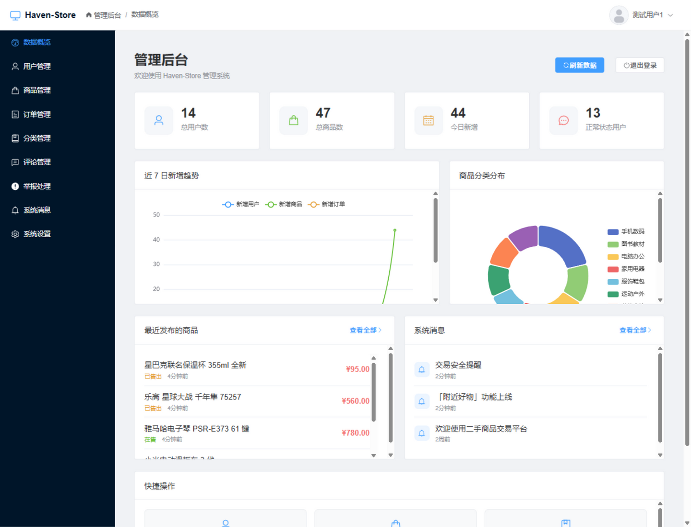

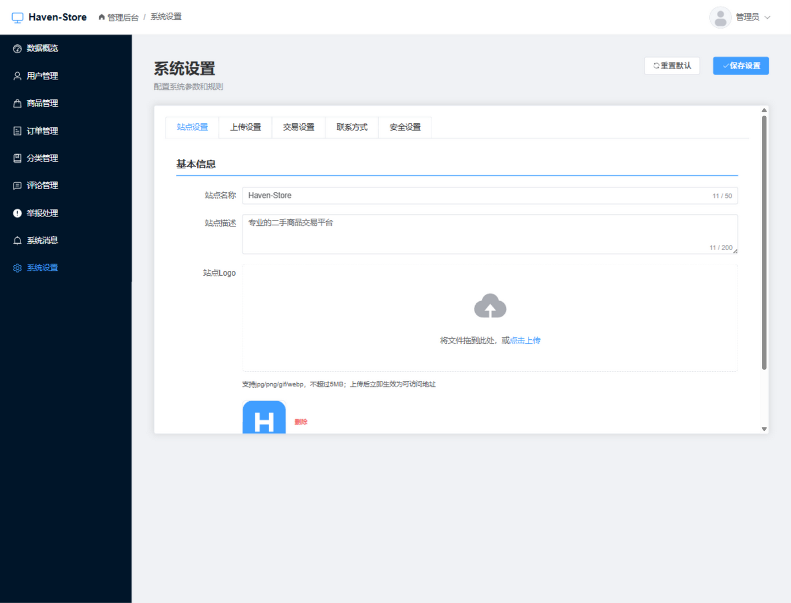

---

## 五、项目中涉及的关键技术

### 5.1 后端：分层架构 + 统一约定

采用经典分层：`controller → service（接口）→ serviceImpl → mapper → entity`，并按业务域切包（`user`、`product`、`order`、`message`、`report`、`cart`、`admin`、`health`、`task`），DTO 入参 / VO 出参分离，实体不直接出网。

- **统一响应与异常**：`Result<T>` + `ResultCodeEnum` 统一返回结构；`GlobalExceptionHandler` 兜底；参数校验用 `spring-boot-starter-validation` 声明式注解（`@NotBlank/@Size/@Digits/@Pattern`）。
- **鉴权**：`JwtInterceptor` 在 `WebMvcConfig` 中注册并配置放行名单（登录注册、商品搜索、详情等游客可访问接口），每个请求校验 Token 与账号状态（Redis 缓存优先），管理员接口另由 `AdminAuthInterceptor` 二次校验角色。
- **缓存**：Redis 承载登录态、登录失败计数、估价结果（`@Cacheable`）等；`RedisConfig` 收紧反序列化类型白名单，且缓存中不再存放 BCrypt 密文。
- **定时任务**：`MaintenanceTask` 每 10 分钟执行一次，自动取消 30 分钟未支付订单并释放商品、按设置自动下架商品。
- **接口文档**：Knife4j（springfox 3）注解式文档，`/doc.html` 可视化调试。

### 5.2 前端：Vue 3 组合式 + 状态集中管理

- **Vue 3.4 + Vite 5**：组合式 API（`<script setup>`）组织页面；Vite 提供秒级热更新与构建。
- **Vue Router 4 + 路由守卫**：路由按业务模块拆分文件（`router/modules/*.js`），守卫拦截未登录访问与管理员路由越权。
- **Pinia**：登录态、用户资料等集中管理，Token 由 `utils/request.js`（Axios 实例）统一注入，401 统一跳登录。
- **Element Plus + ECharts**：管理后台表格/表单/分页用 Element Plus；数据概览的趋势折线图与品类环形图用 ECharts 渲染。
- **体验细节**：私信发送采用乐观插入上屏，移动端上下堆叠布局；商品列表支持排序与附近模式切换。

### 5.3 数据库与算法

- **索引设计**：`product` 的 `(status, category_id)` 联合索引支撑列表页高频过滤；商品创建时间与经纬度单独建索引，前者用于「最新发布」排序，后者用于附近查询的矩形预过滤。
- **附近商品（LBS）**：先用中心点 ± 半径换算出的矩形范围 `BETWEEN` 做粗筛（走索引），再用 Haversine 公式在 SQL 内算出球面距离并排序，避免全表扫描。
- **AI 估价（规则引擎）**：`ProductAIServiceImpl` 提取特征（标题长度、描述长度、品牌关键词、型号关键词、成色系数、分类基准价），按权重折算基准价并叠加波动，输出建议价、价格区间与置信度；结果按 `标题+描述+成色+分类` 组合缓存，避免重复计算。
- **状态机与一致性**：订单状态 待支付(1) → 已支付(2) → 已完成(4)/已取消(3)；支付与确认收货使用条件更新，避免并发下重复推进状态；下单成功后商品置为已售出，取消后回到在售。

### 5.4 安全机制

| 风险 | 措施 |
| --- | --- |
| 冒用他人身份 | JWT 签名（HS256，密钥走环境变量）+ Redis 登录态；禁用账号即时失效 |
| 口令爆破 | 按后台策略限制失败次数并锁定账号（Redis 计数） |
| 弱口令 | 注册/改密按后台强度策略校验（low/medium/high） |
| 越权操作 | 商品修改/下架/删除、订单查询、私信会话均校验归属，卖家 ID 只从 Token 解析，前端传入一律不信任 |
| 恶意上传 | 扩展名白名单 + 文件头魔数校验（不符即拒） + 大小上限（默认 5MB） |
| 导出注入 | CSV 导出对以 `= + - @` 开头的字段做转义，防公式注入 |
| 消息伪造 | 移除普通用户群发入口，群发能力只保留在管理后台 |
| 反序列化 | Redis 值类型白名单收敛 |

### 5.5 工程化与交付

Maven 多环境打包与 `backend/Dockerfile`、`frontend/Dockerfile`、`config/docker-compose.yml`、`config/nginx.conf`（静态资源与 `/api` 反向代理）；前端 `eslint + prettier` 统一风格；Git 提交按「一次 AI 核心对话 = 一个功能模块的提交」的粒度留痕（共 47 次提交，最早一次为 2026-09-21），配套 10 份 Prompt 过程快照（`docs/001`～`docs/010`）。

### 5.6 关键依赖版本

| 端 | 依赖 | 版本 |
| --- | --- | --- |
| 后端 | Spring Boot / MyBatis-Plus / JJWT / Knife4j / mysql-connector-j | 2.7.12 / 3.5.3.1 / 0.11.5 / 4.1.0 / 8.0.33 |
| 前端 | Vue / Vue Router / Pinia / Element Plus / ECharts / Axios / Vite / ESLint | ^3.4 / ^4.2 / ^2.1 / ^2.4 / ^5.5 / ^1.6 / ^5.0 / ^8.54 |

---

## 六、项目相关图片（运行截图补充）

前文第一至四章已就近展示了 7 张关键截图（登录页、首页、商品列表、商品详情、发布向导、后台数据概览、系统设置）。本章补充其余界面，全部截图均来自本机真实运行环境（`http://localhost:3000`），数据即第 1.5 节的演示数据。

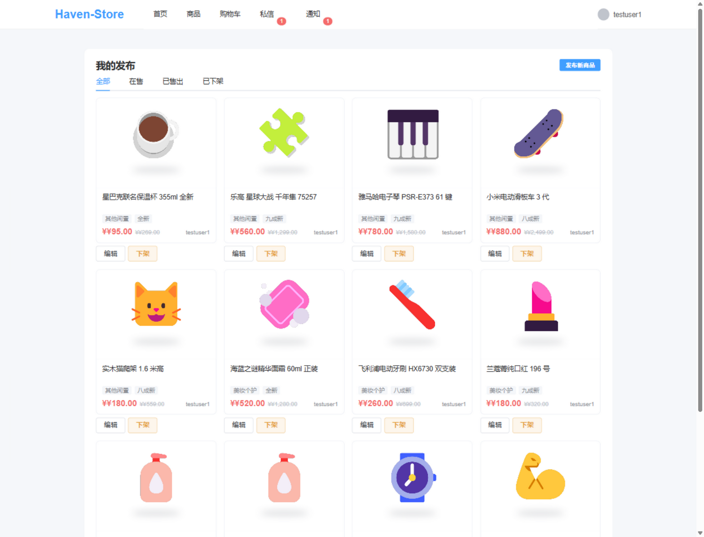

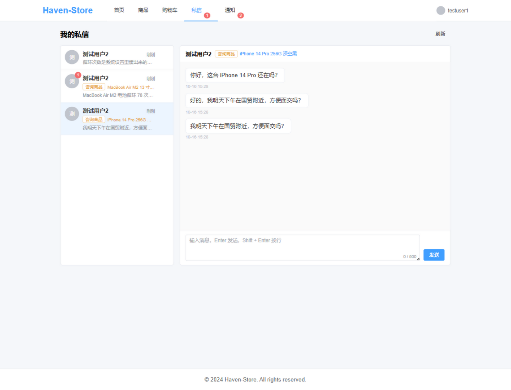

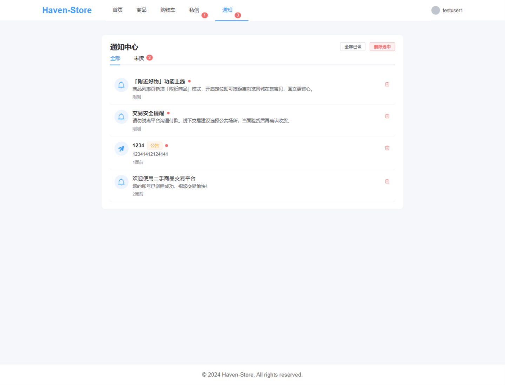

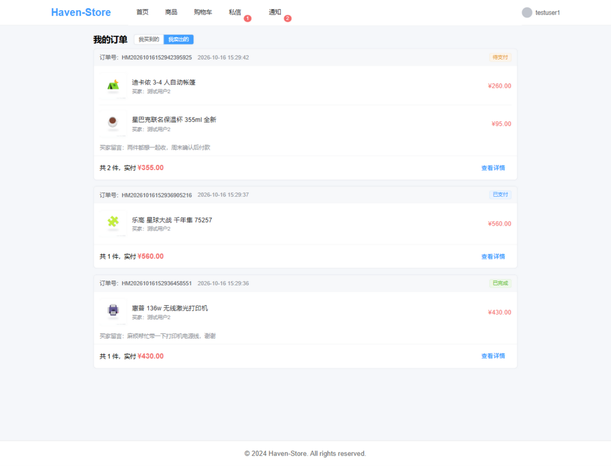

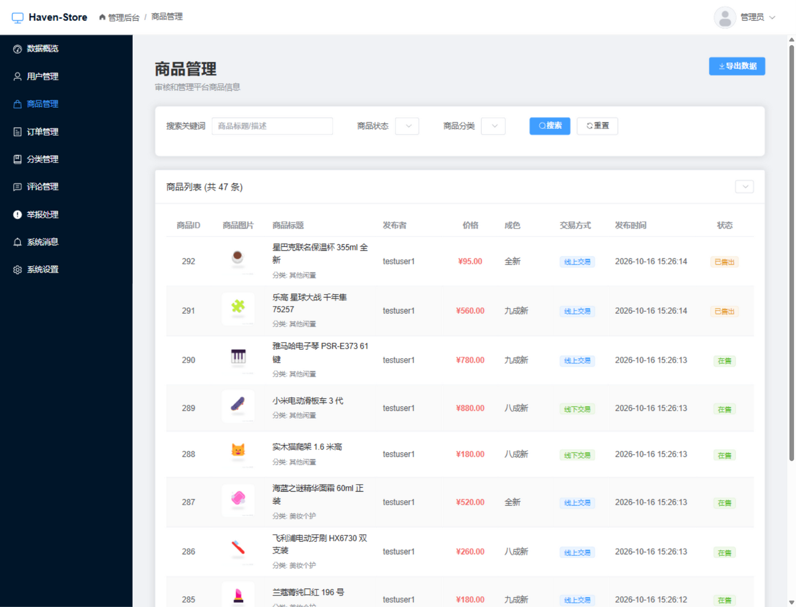

---

## 七、发表与获奖情况说明

**1）本项目未发表、未获奖。** 截至本文档出具日（2026-10-16），Haven-Store 未在任何期刊、会议、竞赛或公开平台上发表过，也没有获得任何奖项或荣誉。它目前是一份可运行的完整代码作品，仅托管于 GitHub 公开仓库以便评审复现。

**2）本项目由 AI 从 0 开始构建生成。** 从第 1 次提交（2026-09-21）起，本项目的全部代码——数据库脚本、后端分层代码、前端页面、测试脚本、部署与 CI 配置——均由 AI 编程助手在人的意图控制下生成，人工工作主要是提出问题、定义规则、确认方案与验收结果。可复现的证据链包括：

- **Git 提交历史**：共 47 次提交，提交信息按模块粒度标注（如 `[AI#001] 搭建工程基础架构与用户模块（注册登录与JWT鉴权）`），保留了完整的演进过程，不存在「一次性提交全部代码」的情况；
- **Prompt 过程快照**：`docs/001` ～ `docs/010` 共 10 份文档，记录了每次会话的用户指令原文、系统约束与关键上下文，可用于还原「需求 → 生成 → 修复 → 验收」的完整过程；
- **可复现的验收口径**：任何人按第二章步骤即可跑出 340 项接口断言与 66 项单元测试的全绿结果，不需要信任本文档的任何叙述。

**3）原创性说明。** 本项目未基于任何已有开源项目二次包装：目录结构、数据库表设计、接口定义、前端页面与测试脚本均为本项目自行生成与实现。仓库自带的 2 张种子商品图为 AI 生成的示意图；本轮补充的 44 件演示商品图由 `scripts/seed_demo_products.py` 用程序合成（白底商品照 + 淡色水印），不引用任何第三方版权图片。第三方依赖（Spring Boot、Vue、Element Plus 等）均为公开开源软件，按各自许可协议使用。

**4）后续计划。** 若作品进入后续评审环节，计划继续补强三块：AI 估价接入更细的特征与可解释依据（当前为规则引擎模拟）、增加订单支付链路的并发用例、以及把安全扫描纳入 CI 而非仅开发环境。

---

*文档结束　|　Haven-Store 二手商品交易平台　|　v1.0　2026-10-16*
